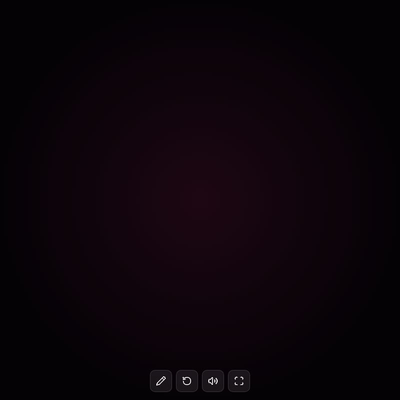
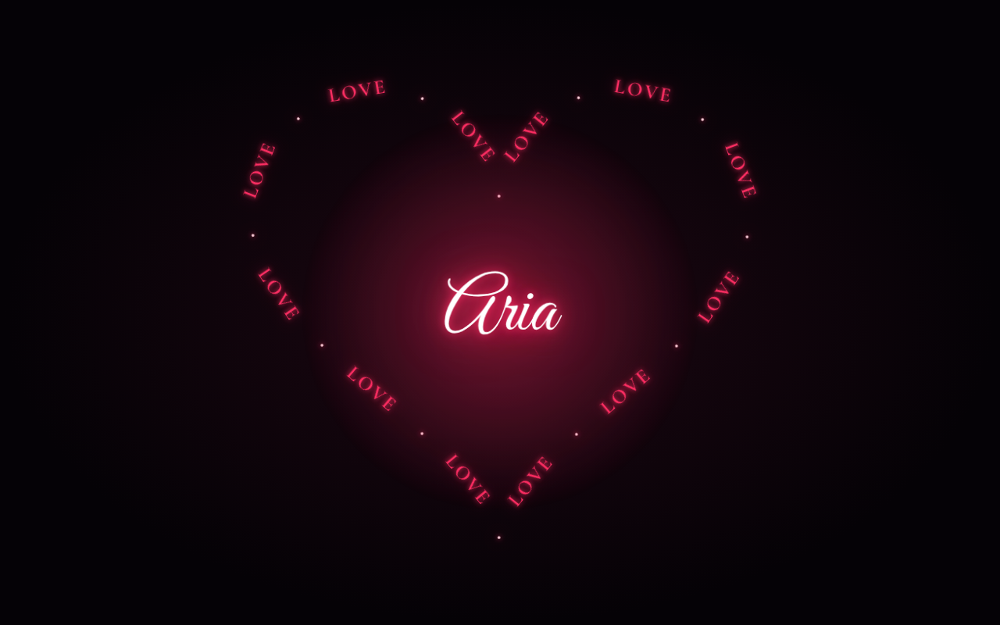
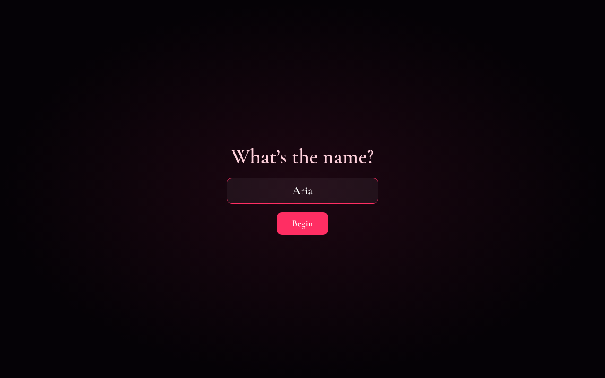
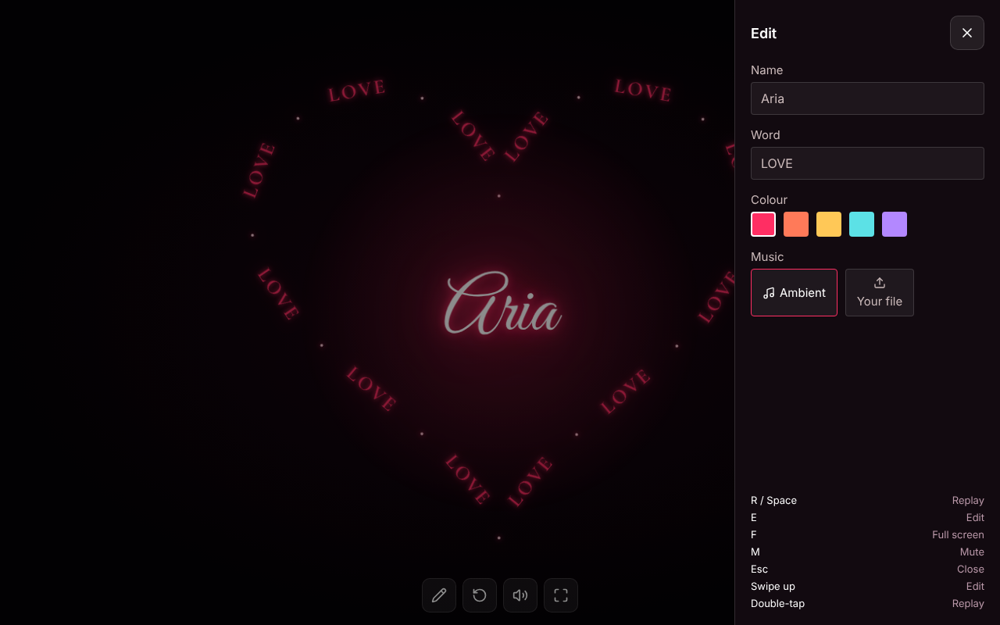
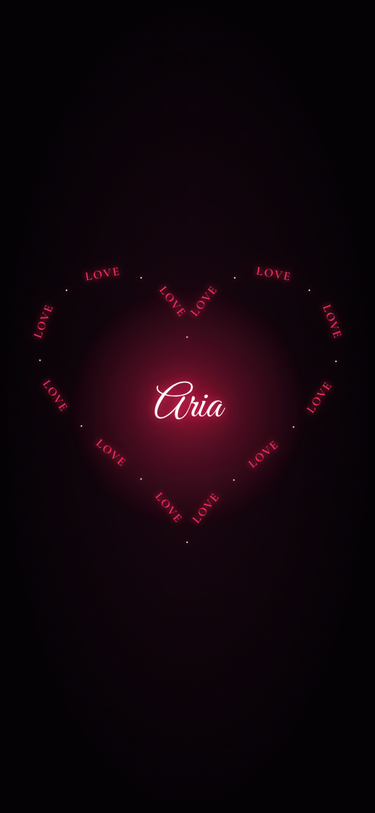
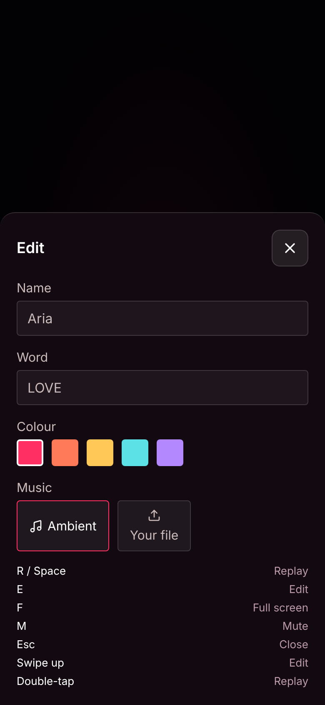

<div align="center">



# Love

Letters fly in and form a glowing heart around a name.<br>
A single-screen animation with an edit menu, full-screen mode, keyboard shortcuts, touch gestures and ambient music.


[](https://react.dev)
[](https://vite.dev)

[](https://love-five-indol.vercel.app/)

&nbsp; [Report a bug](https://github.com/DSwebTEAM/love/issues)

</div>

## Overview

Enter a name and the word "LOVE" flies in from every direction, spinning and blurred, and settles into a heart. The name appears in the exact centre with a soft glow while the heart beats gently. Everything is editable on the fly: the name, the word, the colour and the music.

There is no landing page and no scrolling. It is one dark screen made to be shown full screen, on a phone, a laptop or a projector.

## Screenshots

<p align="center">
  
</p>

| Start screen | Edit menu |
|---|---|
|  |  |

<p align="center">
  
  &nbsp;&nbsp;&nbsp;
  
</p>

## Features

- Letters fly in, rotate and blur-in, then lock onto the heart outline
- Name locked to the exact centre of the screen, editable at any time
- Edit menu: name, word, five colours, and music source (side drawer on desktop, bottom sheet on mobile)
- Full-screen mode, keyboard shortcuts and touch gestures
- Ambient music generated in the browser, or play any audio file from your device
- Controls fade out when idle, so the screen stays clean
- Settings are remembered between visits
- Respects reduced-motion settings and pauses sound when the tab is hidden

## Controls

| Key | Action |
|---|---|
| `R` / `Space` | Replay the animation |
| `E` | Open or close the edit menu |
| `F` | Toggle full screen |
| `M` | Mute or unmute |
| `Esc` | Close the edit menu |

| Touch | Action |
|---|---|
| Swipe up | Open the edit menu |
| Double-tap | Replay the animation |

iPhone Safari has no Fullscreen API, so the full-screen button hides itself there. Adding the page to the home screen gives an app-like view.

## Getting started

Requires Node.js 20.19 or newer (22 LTS recommended).

```bash
git clone https://github.com/DSwebTEAM/love.git
cd love
npm install
npm run dev
```

| Command | What it does |
|---|---|
| `npm run dev` | Start the development server |
| `npm run build` | Production build into `dist/` |
| `npm run preview` | Serve the production build locally |

If `npm install` complains about peer dependencies, add `--legacy-peer-deps`.

## Customising

| To change | Where |
|---|---|
| Default name, word and colour | `DEFAULTS` in `src/App.jsx` |
| Number of words and fly-in timing | `N` and `STAGGER` in `src/components/Heart.jsx` |
| Colour choices | `SWATCHES` in `src/components/EditPanel.jsx` |
| Chord progression | `CHORDS` in `src/lib/sound.js` |
| Heart size | `.heart` width in `src/styles.css` |

Keep `N` a multiple of 4. That places a dot, not a word, on the top cleft and the bottom tip, where the outline turns sharply.

To ship a default track, put the file in `public/` and load it with `new Audio(`${import.meta.env.BASE_URL}track.mp3`)` in `src/lib/sound.js`. Only use music you have the rights to.

## Deployment

Pushing to `main` builds and publishes the site to GitHub Pages through `.github/workflows/deploy.yml`.

1. Push the project to a public repository.
2. Open **Settings > Pages** and set **Source** to **GitHub Actions**.
3. Watch the **Actions** tab. When the run finishes, the site is live at `https://<owner>.github.io/love/`.

GitHub Pages is free for public repositories. Private repositories need a paid plan.

The build uses relative paths, so the same output also works from any subfolder or static host. For Cloudflare Pages use build command `npm run build` and output directory `dist`.

## How it works

- Letters are placed by arc length along a parametric heart curve, with each word rotated to the tangent. Positions are stored in percent of a square box, so nothing is recalculated on resize.
- The fly-in uses the Web Animations API on `transform`, `opacity` and a short blur only, so it runs on the compositor with no animation library.
- The glow is a separate pulsing gradient layer. Only its opacity animates, so the text is never repainted.
- Music is a small Web Audio synth (detuned sine voices through a slow low-pass filter), so there are no audio files and no licensing to manage.
- Fonts are bundled with Fontsource, so the page makes no third-party requests.

## Project structure

```
src/
  App.jsx                   state, keyboard, touch, full screen
  components/
    Heart.jsx               the animation
    EditPanel.jsx           edit menu
  lib/
    heart.js                heart path and letter placement
    sound.js                ambient synth and file playback
  styles.css
public/favicon.svg
docs/screenshots/           images used in this README
.github/workflows/deploy.yml
```

## Browser support

Current versions of Chrome, Edge, Firefox and Safari. The page uses `color-mix()` and the Web Animations API.

## Credits

- Fonts: Cormorant Garamond and Great Vibes (SIL Open Font License), via [Fontsource](https://fontsource.org)
- Icons: [Lucide](https://lucide.dev)

## License

Released under the [MIT License](LICENSE).
